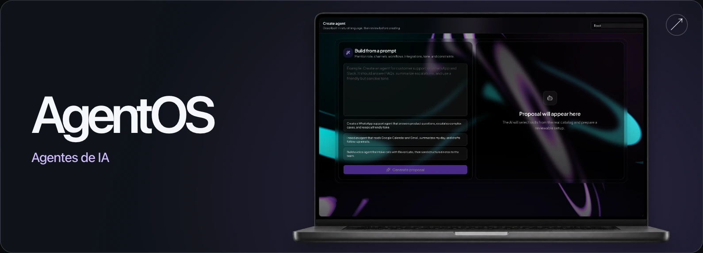

# AgentOS

Crea agentes de IA y conecta sus herramientas, permisos y aprobaciones en un solo lugar.

<a href="https://clyra.dev/portfolio/agentos">
  <picture>
    <source media="(max-width: 650px)" srcset="./media/movil.webp">
    
  </picture>
</a>

Describe la tarea para crear un agente o empieza desde una plantilla. En su configuración eliges qué herramientas puede utilizar y qué acciones necesitan aprobación. El historial te permite revisar lo que hizo y retomar la conversación.

[**Explora el proyecto**](https://clyra.dev/portfolio/agentos)　·　[Galería de pantallas](https://clyra.dev/portfolio/agentos#project-gallery)　·　[Estudio Clyra](https://clyra.dev/)

## Demo en Python

Agrupa tres tareas ficticias según necesiten revisión antes de ejecutarse. El programa solo imprime la lista. Es un ejemplo independiente preparado para esta ficha pública.

```sh
python3 aprobaciones.py
```
